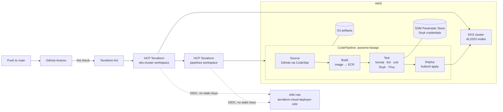

# AWS DevSecOps Pipeline (Terraform · EKS · CodePipeline)


Infrastructure as code for a cloud-native DevSecOps pipeline on AWS. GitHub Actions drives HCP Terraform, which provisions an Amazon EKS cluster and an AWS CodePipeline that builds, tests, security-scans and deploys a containerized FastAPI application ([`awsome-fastapi`](https://github.com/amahjoshdevsec/awsome-fastapi)).

> **Origin:** this project started from the [DevSec Blueprint](https://devsecblueprint.com/walkthroughs/devsecops-pipeline-aws) walkthrough by Damien Burks. The upstream template had drifted from current AWS, Debian and dependency versions; getting it working end to end, and hardening it, is documented in [What I changed](#what-i-changed).

---

## Architecture



| Component | Purpose |
|---|---|
| **GitHub Actions** (`.github/workflows`) | On push to `main`: checks Terraform formatting, then applies the `eks-cluster` workspace, then `pipelines` |
| **HCP Terraform** | Remote state and runs. Assumes an AWS IAM role through OIDC dynamic credentials, so no AWS keys are stored anywhere |
| **Amazon EKS** | Kubernetes 1.36 (pinned), managed node group of 2× `t3.medium` on Amazon Linux 2023 |
| **AWS CodePipeline + CodeBuild** | Seven CodeBuild projects: build, format check, lint, unit tests, Snyk, Trivy, deploy |
| **Amazon ECR / S3 / SSM** | Container images, pipeline artifacts, Snyk credentials (`SecureString`) |

## Pipeline stages and security gates

| Stage | Action | Tool | Fails the pipeline when |
|---|---|---|---|
| Source | Source | CodeStar connection (GitHub App) | n/a |
| Build | Build | Docker → ECR | image build or push fails |
| Test | FormatCheck | `black --check` | code is not formatted |
| Test | LintCheck | `pylint` | lint errors |
| Test | RunUnitTests | `pytest` | any test fails |
| Test | SnykSecurityScan | `snyk test` (SCA) | a **High/Critical** dependency vulnerability exists |
| Test | SnykSecurityScan | `snyk code test` (SAST) | **never**: report-only, see below |
| Test | ContainerSecurityScan | Trivy `v0.76.0` | a **High/Critical** image vulnerability **with a fix available** exists |
| Deploy | DeployToEKS | `kubectl` `v1.36.5` (checksum-verified) | manifest apply fails |

**Gate policy, deliberately:**

- **Snyk Code is report-only.** The demo app is intentionally vulnerable (SQL injection, path traversal, hardcoded secret) so the scanners have something to find. Gating on it would block every run.
- **Trivy prints the full report but gates only on fixable findings** (`--ignore-unfixed`). Base images routinely carry OS CVEs with no upstream patch yet; blocking on those stops delivery without improving security. Fixable findings are actionable, so they block.

## Repository layout

```
.github/workflows/
  main.yml                       # orchestrator: lint → eks-cluster → pipelines
  terraform-lint.yml             # terraform fmt -check -recursive
  terraform-apply-eks.yml        # HCP Terraform run for terraform/eks-cluster
  terraform-apply-pipelines.yml  # HCP Terraform run for terraform/pipelines
terraform/
  eks-cluster/                   # workspace 1: EKS cluster, node group, IAM
    modules/eks/
  pipelines/                     # workspace 2: CodePipeline and everything around it
    buildspecs/awsome-fastapi/   # app-specific build.yml and deploy.yml
    modules/
      codepipeline/              # pipeline, 7 CodeBuild projects, ECR, IAM, SSM
        buildspecs/              # shared test and scan buildspecs
      eks-config/                # aws-auth mapping for CodeBuild and admin user
      s3/                        # artifact bucket
```

## Deploying it yourself

**Prerequisites:** AWS account, HCP Terraform account, Snyk account, GitHub account, Terraform CLI. Fork this repo and [`awsome-fastapi`](https://github.com/amahjoshdevsec/awsome-fastapi).

1. **AWS OIDC trust.** In IAM, add the identity provider `https://app.terraform.io` (audience `aws.workload.identity`). Create a role whose trust policy allows `sts:AssumeRoleWithWebIdentity` for your runs, for example:
   ```
   app.terraform.io:sub = organization:<ORG>:project:<PROJECT>:workspace:<WORKSPACE>:run_phase:*
   ```
   The `sub` claim must match your org, project **and** workspace names exactly, or every plan fails with `AccessDenied`.
2. **HCP Terraform.** Create two CLI-driven workspaces, one per Terraform root. Add an org variable set with the environment variables `TFC_AWS_PROVIDER_AUTH=true` and `TFC_AWS_RUN_ROLE_ARN=<role ARN>`. In the pipelines workspace, add the sensitive Terraform variables `SNYK_TOKEN` and `SNYK_ORG_ID`.
3. **Point the code at your accounts.** Update the organization and workspace names in both `provider.tf` files and both `terraform-apply-*.yml` workflows. In `terraform/pipelines/main.tf`, set `repository_id` to your `awsome-fastapi` fork and the IAM user in `cluster_auth`.
4. **GitHub.** Add an HCP Terraform API token as the repository secret `TF_API_TOKEN`.
5. **Deploy.** Push to `main` or run the workflow manually. The first apply takes about 15–20 minutes, mostly EKS.
6. **Activate the GitHub connection.** In the AWS console, go to Developer Tools → Settings → Connections, open the pending `github-connection-*`, and install the AWS Connector for GitHub on your account. Then **Release change** on the `awsome-fastapi` pipeline.

## Tearing it down

EKS bills while it runs, so destroy everything when you're done. **Order matters:** destroy `pipelines` first, because its `cluster_auth` module reads the live cluster.

```bash
cd terraform/pipelines   && terraform destroy
cd ../eks-cluster        && terraform destroy
```

Disable the GitHub workflow first, otherwise the next push to `main` recreates everything. If the cluster is already gone, run `terraform state rm module.cluster_auth` in `terraform/pipelines` before destroying (the `aws-auth` ConfigMap was deleted with the cluster).

## What I changed

The upstream template no longer deployed. I fixed each failure at its root cause, then hardened the pipeline:

| Problem | Root cause | Fix |
|---|---|---|
| HCP Terraform `unauthorized` | Workflows and `cloud {}` blocks targeted the template's org | Pointed both at my HCP organization |
| HCP Terraform `resource not found` | Workspace names didn't match my project | Aligned workspace names in workflows and `provider.tf` |
| `AccessDenied: sts:AssumeRoleWithWebIdentity` | OIDC trust policy's `sub` claim was scoped to a different HCP project | Added my project and workspaces to the trust policy, scoped per workspace rather than `*` |
| EKS `CreateNodegroup` 400 | Unpinned cluster version defaulted to 1.36; `AL2_x86_64` AMIs stop at 1.32 | Switched nodes to `AL2023_x86_64_STANDARD` and **pinned** the Kubernetes version |
| Docker build `apt` 404s | Base image on Debian 11, which is end-of-life | Moved to `python:3.12-slim-bookworm` (in the app repo) |
| Pipeline built the wrong code | `repository_id` pointed to the upstream repo, not my fork | Pointed the source at my fork |
| Snyk gate failed (8 High/Critical) | Pinned 2024 dependencies (certifi, h11, starlette, …) | Upgraded and resolved transitive conflicts (FastAPI↔Starlette 1.x, black↔pathspec) (in the app repo) |
| Deploy would use an unsupported kubectl | kubectl 1.24 against a 1.36 cluster (outside the ±1 skew policy) | Pinned kubectl to `v1.36.5` with SHA-256 verification |
| Trivy never blocked anything | Ran with `--exit-code 0` | Gate on fixable High/Critical findings; pinned the Trivy version instead of installing from `main` |
| Lint workflow never ran | `terraform-lint.yml` wasn't called | Added it as the first job in `main.yml`, now recursive |
| Deprecation warnings | Node 20 actions, CodeBuild `standard:5.0` (Ubuntu 20.04), deprecated `kubernetes_config_map` | `checkout@v7.0.1`, `setup-terraform@v4.0.1`, `tfc-workflows-github@v1.3.2`, `standard:7.0`, `kubernetes_config_map_v1` |

## Design trade-offs and production hardening

This is a learning environment, optimized for clarity and cost. What I'd change for production:

| Current choice | Trade-off | Production approach |
|---|---|---|
| Deployer role has `AdministratorAccess` | Simple, but any compromised run owns the account | Scoped policy per workspace; separate plan (read-only) and apply roles via `TFC_AWS_PLAN_ROLE_ARN` / `TFC_AWS_APPLY_ROLE_ARN` |
| CodeBuild and admin mapped to `system:masters` via the `aws-auth` ConfigMap | `aws-auth` is deprecated, and `system:masters` can't be restricted by RBAC | EKS access entries with namespace-scoped RBAC for CodeBuild |
| Push to `main` applies immediately | Fast, but there's no human review of the plan | Speculative plans on pull requests, apply on merge, branch protection |
| Two workspaces with an implicit dependency | Separate blast radius, but `pipelines` reads the cluster directly, which complicates teardown | Pass outputs via `tfe_outputs`, and make the dependency explicit |
| Image tagged `:latest` | `kubectl apply` won't roll pods if the manifest doesn't change | Tag images with the commit SHA |
| Default VPC, public EKS endpoint | Cheap and simple; exposes the API server publicly | Private subnets with NAT, a private or CIDR-restricted endpoint |
| `TF_API_TOKEN` is a long-lived GitHub secret | AWS access is keyless, but HCP access isn't | Team-scoped token with rotation |
| Snyk token stored as a Terraform variable | Ends up in Terraform state (encrypted at rest in HCP) | Create the SSM parameter out of band and reference it by name |
| Two CI systems (Actions for infrastructure, CodePipeline for the app) | AWS-native IAM for app deploys, but two systems to maintain | Consolidate on one, or keep the split and document ownership |

## License

MIT. See [LICENSE](LICENSE). Original template © The DevSec Blueprint.
